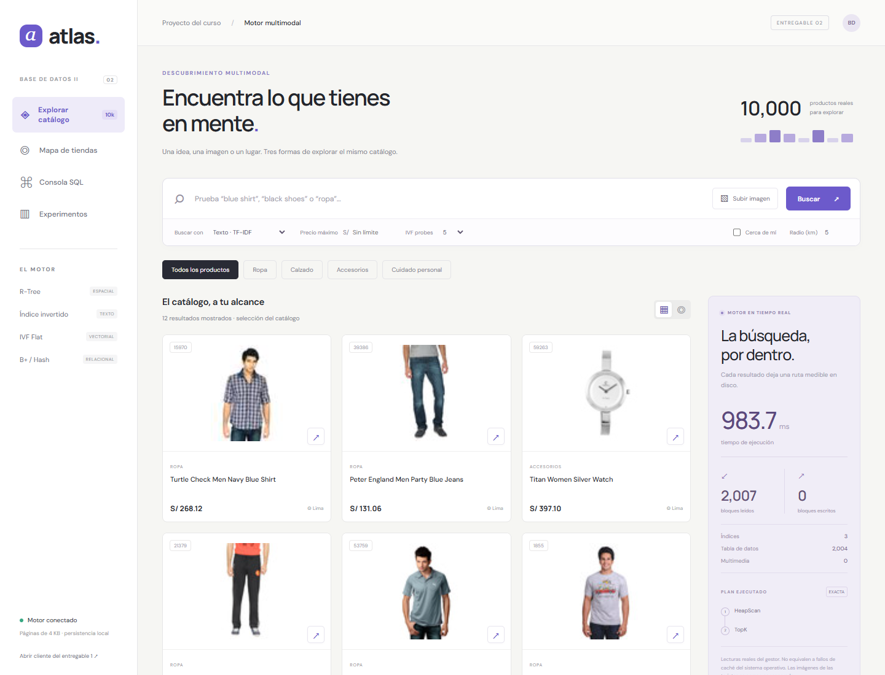

# Atlas · Motor multimodal en disco

**Entregable 2 · Base de Datos II (CS2042), 2026-II**

Un recomendador de productos con **R-Tree, índice invertido, BoVW e IVF implementados desde cero sobre páginas binarias de 4 KB**. Integra el Heap, B+, Hash y SQL del entregable 1. La aplicación compara búsqueda por texto, imagen y ubicación y muestra el costo real de cada consulta.



**Equipo:** Ivan Alonso Rodriguez Perez · Yacira Nicol Campoverde San Martín · Jorge Armando Martinez Palomino · Leonardo Alberto Montesinos Damian. **Docente:** Percy Lovon Ramos.

## Ejecutar todo en un paso

Desde la raíz, con **Python 3.12** instalado e internet en la primera preparación:

```bash
python setup.py --full
```

Si Windows abre Microsoft Store al usar `python` y el proyecto ya tiene `.venv`, ejecuta `.\.venv\Scripts\python.exe setup.py --full` desde la raíz del proyecto.

El comando crea `.venv`, instala dependencias, descarga un shard de Fashion Product Images (136 MB) y los pesos ResNet-18 (45 MB), extrae características de 10100 imágenes, construye la colección de 10000 productos e inicia API + frontend. La instalación de PyTorch añade su propia descarga; reserva aproximadamente 3 GB libres. La primera preparación tarda varios minutos según el equipo. Conserva datos y características ya preparados.

El descargador verifica tamaño, SHA-256 y metadatos Parquet antes de reutilizar el dataset. Si detecta una descarga o un `source.json` dañado, vuelve a descargarlo automáticamente; una descarga incompleta no reemplaza el archivo anterior.

Abre **http://127.0.0.1:8000**. Documentación de la API: **http://127.0.0.1:8000/docs**. Detener: Ctrl+C. No abras el HTML como archivo.

Para los siguientes inicios:

```powershell
.venv\Scripts\python.exe run.py
```

En Linux/macOS: `.venv/bin/python run.py`. Para preparar sin iniciar: `python setup.py --full --no-start`. Para usar dependencias ya instaladas: `--skip-install`. Otro puerto: `python run.py --port 8001`. Otro directorio: `python run.py --data-dir RUTA`.

En el espacio local donde se desarrolló esta entrega, `.venv` y el catálogo ya están preparados. En una clonación nueva deben regenerarse: los datos masivos y los pesos no están en Git.

## Qué probar

1. Buscar `blue shirt`, `black shoes` o `ropa` por texto.
2. Elegir **Texto · Booleano** y buscar `black AND shoes AND NOT women`.
3. Fijar precio máximo y categoría; observar B+/Hash en el plan.
4. Pulsar **↗** en una tarjeta o **Subir imagen**. Comparar **ResNet + IVF**, **SIFT + BoVW** y **k-NN exacto** con la misma referencia.
5. Variar `probes`: menos listas reducen lecturas, con posible pérdida de recall.
6. Abrir **Mapa de tiendas**, activar cercanía y mover el centro con un clic. **Ubicación · k-NN** devuelve los más cercanos dentro del radio y filtros.
7. Ejecutar los ejemplos de **Consola SQL** y revisar **Experimentos**.

Las imágenes, títulos y categorías son reales. **Precios y ubicaciones de tiendas son sintéticos**, reproducibles con semilla 2026, porque el dataset no contiene esos campos. Las descripciones concatenan atributos originales y etiquetas de categoría en español. La interfaz lo indica; no representa inventario comercial. Las teselas del mapa y las fuentes web requieren internet; los índices, las imágenes y la API residen localmente.

Las tiendas sintéticas se distribuyen por zonas urbanas del norte, centro, este y sur de Lima Metropolitana y Callao mediante `data/store_locations.py`. Se usa una mezcla gaussiana de centros de simulación y se rechazan puntos fuera de una máscara continental obtenida de los límites INEI/MINAM, con un margen interior aproximado de 350 m respecto al contorno. No representan tiendas reales ni densidades comerciales medidas. La máscara está incluida en `data/geography/lima_land.geojson`; no necesita internet ni Shapely para generar ubicaciones. Para actualizar una colección antigua, detén la API y ejecuta `python tools/repair_store_locations.py`. La utilidad conserva una copia de seguridad en `data/database/.location-backups`, modifica solo lon/lat y reconstruye el R-Tree manteniendo los RID, precios, imágenes y demás índices.

Las tarjetas tienen paginación de 12 productos: Anterior/Siguiente, primera/última página y salto a un número de página. El contador muestra el intervalo y el total de coincidencias; cambiar la búsqueda o los filtros vuelve a la primera página. Se conserva el orden por relevancia textual, similitud visual o distancia; en IVF se recorren los candidatos de las listas seleccionadas por `probes`.

El mapa del catálogo muestra todos los productos que cumplen los filtros de categoría, precio, texto y radio; sin filtros incluye los 10000 productos. Cambiar de página en las tarjetas no limita ese mapa. Las búsquedas por similitud visual y k-NN geográfico muestran los 12 mejores resultados en la vista de mapa. La ruta `/api/multimodal/map` recupera todas las coincidencias de catálogo/texto/radio; `/search` acepta `k` como tamaño de página y `offset` como desplazamiento, y devuelve `total_rows`, `offset` y `limit`.

## Mapa con API key de Google Maps

1. En tu proyecto de Google Cloud, habilita Maps JavaScript API, configura la facturación y crea una API key siguiendo la [guía oficial](https://developers.google.com/maps/documentation/javascript/get-api-key).
2. Copia `.env.example` a `.env` en la raíz y completa `GOOGLE_MAPS_API_KEY=tu_clave_real`.
3. Reinicia con `.venv\Scripts\python.exe run.py` y recarga la página. Docker Compose también lee esa variable desde `.env`.

La clave se configura fuera del código versionado; `.env` está excluido de Git. El navegador utiliza esta clave para cargar el SDK oficial. En Google Cloud, limita la clave a Maps JavaScript API y a sitios web; para este entorno local añade `http://127.0.0.1:8000/*` y `http://localhost:8000/*`. Una variable de entorno definida en el sistema tiene prioridad sobre `.env`.

Si la clave está vacía, se utiliza OpenStreetMap con Leaflet y su atribución visible. El navegador solicita las teselas de `https://tile.openstreetmap.org/{z}/{x}/{y}.png` respetando su caché; no hay descarga masiva ni modo offline. Este uso interactivo sigue la [política del servicio de teselas de OpenStreetMap](https://operations.osmfoundation.org/policies/tiles/). La integración de Google no incluye una clave real: debe provenir de la cuenta del equipo. Con clave configurada, Google Maps muestra los productos, sus fichas y el radio de búsqueda; los resultados siguen recuperándose mediante el R-Tree propio. Los errores de clave, permisos o conexión aparecen junto al mapa sin borrar los resultados.

## Entregables y evidencia

- [Informe técnico PDF](informe/main.pdf) y [fuente LaTeX](informe/main.tex), con los cuatro integrantes, diagramas, formatos físicos, tablas, gráficas, análisis y límites.
- [Matriz de requisitos](docs/TRAZABILIDAD.md), [arquitectura](docs/ARQUITECTURA.md) y [SQL/API multimodal](docs/SQL_P2.md).
- [Guion de sustentación de 7-8 minutos](docs/SUSTENTACION.md), con una sección para cada integrante. **Queda a cargo del equipo grabar su participación real y añadir el enlace del video a la entrega del curso.**
- [CSV, gráficas y verificaciones P2](benchmarks/p2/results), incluyendo los [planes EXPLAIN de PostgreSQL](benchmarks/p2/results/exp6_postgres_plans.json).
- [Procedencia de datos y dependencias](docs/FUENTES.md).

El motor se validó con **10000 productos**, **100 imágenes de consulta fuera del índice**, **20000 textos** en el experimento 6 y hasta **100000 puntos** en el experimento 5. Los resultados de P1 en `benchmarks/results` se conservan como evidencia heredada y no se presentan como nuevas mediciones de P2.

| Comparación real | Resultado |
|---|---:|
| Precision@10 · SIFT/BoVW | 0.295 |
| Precision@10 · ResNet-18 + IVF, probes=5 | 0.688 |
| Recall@10 · IVF, probes=5 | 0.971 |
| Recall@10 · IVF, probes=100 | 1.000 |

Relevancia visual = misma etiqueta `articleType`. Recall = coincidencia con k-NN exacto en el mismo corpus. Los tiempos dependen de hardware y caché; consultar CSV e informe para medias, dispersión y condiciones.

## Índices propios e integración P1

| Subsistema | Implementación |
|---|---|
| Almacenamiento | `DiskManager`, páginas 4096, Heap de P1, RID; JPEG en cadenas de blobs |
| Espacial | R-Tree multinivel, mínima ampliación, Linear Split, ventana, radio refinado y k-NN con MINDIST |
| Textual | Snowball, stoplists ES/EN; `vocab.dic`, `postings.inv`, normas L2; mezclas AND/OR/AND-NOT y TF-IDF/coseno |
| Visual clásico | SIFT 128D, K-Means propio, 128 palabras visuales, índice invertido TF-IDF |
| Denso | ResNet-18 ImageNet 512D; exacto coseno/L2 e IVF Flat con directorio y listas paginadas |
| Híbrido | B+ precio + Hash categoría + R-Tree/texto + ranking; plan e I/O separado de tabla/índice/blob |
| API y web | FastAPI, cliente JS, Leaflet local, carga de imágenes, consola y experimentos |

No se utiliza una base externa, ORM o biblioteca de índices para la aplicación. **PostgreSQL solo existe en el benchmark 6**. OpenCV, NLTK y PyTorch extraen/transforman características; no gestionan almacenamiento. NumPy implementa operaciones numéricas del K-Means propio.

La base P1 proviene de [ArmandoPal/BD2_proyecto](https://github.com/ArmandoPal/BD2_proyecto), commit `1634a747b97d71bea83fe02f00d18b6ef14028f0`. Se conserva su historial Git y su [documentación original](docs/ENTREGABLE_1_HEREDADO.md), que describe el contexto de esa fase y puede mencionar archivos locales no incluidos en esta copia.

## Pruebas

Con el entorno virtual activo:

```bash
python -m pytest backend/tests -q
python tools/validate_multimodal.py
```

La suite verifica persistencia, splits recursivos, duplicados, merges booleanos contra conjuntos, coseno contra una fórmula independiente, IVF contra exacto, filtros híbridos, SQL, errores de API, límites geográficos y regresiones del motor P1. La evidencia de la última ejecución está en `benchmarks/p2/results/tests.xml`. La validación real comprueba todos los RID y 100 JPEG después de reabrir los archivos.

QA de navegador opcional, con Playwright y Chrome instalados: `node tools/check_multimodal.cjs`. Variables opcionales `PLAYWRIGHT_MODULE`, `CHROME_PATH`, `BD2_URL`. El resultado se guarda en `frontend_validation.json`. CI ejecuta las pruebas unitarias y HTTP sin descargar el corpus ni los pesos.

## Repetir experimentos 5-8

Con Docker Desktop/Engine en funcionamiento:

```bash
docker compose --profile benchmark up -d postgres
python -m benchmarks.p2.run_all
```

La conexión local de referencia usa `127.0.0.1:55432`, base/usuario `atlas_bench`, contraseña **de desarrollo** `atlas_bench_local`. No es un servicio de producción. Los scripts actúan sobre su tabla de benchmark `atlas_p2_bench_docs`.

Por separado:

```bash
python -m benchmarks.p2.spatial
python -m benchmarks.p2.textual
python -m benchmarks.p2.visual
```

La opción `--quick` escribe en `benchmarks/p2/smoke-results`, sin sobrescribir la evidencia completa. `--skip-postgres` permite una prueba parcial y se declara como tal; el informe final exige resultados GIN. Las ejecuciones completas actualizan los CSV y PNG versionados. Después, recompila el informe.

Los contadores de Atlas son transferencias de páginas de **4 KB**, no fallos de caché del SO. PostgreSQL reporta shared hit/read de **8 KB** por separado. Su ranking es `ts_rank_cd`, distinto de TF-IDF; no se equipara su relevancia. GIN usa los mismos tokens con configuración `simple` y SeqScan desactivado para aislar el índice. Los planes completos quedan en JSON.

## Inspeccionar páginas y compilar informe

```bash
python tools/inspect_page.py data/database/productos.bin --page 1
python tools/inspect_multimodal.py data/database/multimodal/geo.idx --page 0
python tools/inspect_multimodal.py data/database/multimodal/text/vocab.dic --page 1
python tools/inspect_multimodal.py data/database/multimodal/ivf/lists.ivf --page 1
python tools/build_p2_report.py
```

El informe necesita Tectonic o `pdflatex` en PATH, o `--compiler RUTA`. Las tablas se generan desde CSV; el PDF no contiene cifras escritas manualmente. Salidas: `informe/main.pdf` y copia en `output/pdf/entregable_2_atlas.pdf`.

## Despliegue con Docker

Primero prepara el dataset con `python setup.py --full --no-start`. Después:

```bash
docker compose up --build -d atlas
```

Abre `http://127.0.0.1:8000`. El contenedor monta `data/database` y `.cache/torch`, usa PyTorch CPU y conserva los datos fuera de su sistema de archivos. Detén cualquier servidor previo que use el puerto 8000. Para detener servicios: `docker compose --profile benchmark stop`. El despliegue documentado es local; no se presenta GitHub como hosting del backend.

## Estructura

```text
backend/core/storage/       DiskManager, contador, páginas y RID de P1
backend/core/file_org/      Heap / Sequential heredados
backend/core/indexes/       B+ / Hash heredados
backend/core/multimodal/    R-Tree, texto, IVF, características, SQL y colección P2
backend/api/               API relacional + recomendador
backend/tests/             Pruebas P1 y P2
frontend/                  Catálogo P2; sql.html conserva cliente P1
data/                      Descarga, extracción e importación reproducibles
benchmarks/p2/             Experimentos 5-8 y evidencia real
informe/                   LaTeX y PDF
docs/                      Arquitectura, trazabilidad, fuentes y sustentación
tools/                     QA, validación, inspectores y compilador del informe
```

## Límites declarados

- Colección multimodal de solo lectura después de publicarla. INSERT/DELETE/DROP se bloquean para mantener consistencia; las demás tablas conservan el CRUD P1. Reconstruye en otro directorio para cambiar el corpus.
- Un proceso escritor, sin WAL ni transacciones. No coordinar dos servidores sobre los mismos archivos.
- Construcción textual y entrenamiento en RAM; consultas paginadas y cachés acotadas. SPIMI no está implementado.
- IVF 512D almacena un vector por página; su ocupación podría mejorar con otro formato.
- Gramática SQL limitada, sin JOIN, UPDATE ni agregaciones. `SET ivf.probes` es global al proceso; `/search` acepta probes por petición.
- El mapa usa ubicaciones sintéticas y distancia esférica. El benchmark de radio usa grados; la interfaz usa kilómetros.
- Sin autenticación; ejecución por defecto en localhost. La publicación remota requiere configurar un entorno de hosting y seguridad apropiado.
