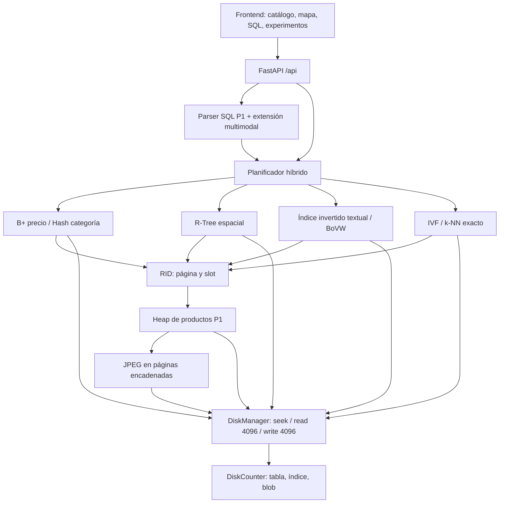

# Arquitectura y formatos físicos

Los datos, índices y blobs usan `DiskManager` de P1. Los únicos JSON de operación son el catálogo de esquemas y el manifiesto de la colección. Las consultas no cargan archivos binarios completos ni reconstruyen los índices en RAM. Los `.npy` son cachés **offline de extracción**, no se consultan para servir búsquedas. NLTK procesa palabras, OpenCV extrae SIFT y PyTorch produce embeddings; ninguna biblioteca administra los índices.

## Formatos (little-endian, páginas de 4096 bytes)

| Archivo | Cabecera / registros | Acceso |
|---|---|---|
| `productos.bin` | Layout P1: cabecera + bitmap + slots de registros de 780 bytes | RID, Heap |
| `geo.idx` | Meta `<4sIIIIQ>`: magic, versión, D, raíz, capacidad, N | Raíz persistente |
| Nodo R-Tree | `<4sIBH>`: magic, page_id, leaf, n; entradas `<4dQ>` en 2D | 102 entradas físicas; referencia de 64 bits |
| `vocab.dic` | Arreglo `<128sQQQ>`: término UTF-8, df, offset absoluto, longitud | Búsqueda binaria en disco |
| `postings.inv` | `<QI>`: doc_id, tf; listas consecutivas ordenadas por doc_id | seek a la página que contiene el offset |
| `norms.norm` | `<Qd>`: doc_id, norma L2; orden por doc_id | Búsqueda binaria, LRU de 32 páginas |
| `centroids.dir` | `<I512fiI>`: cluster, centroide, cabeza, cantidad | Se lee el directorio de C centroides |
| `lists.ivf` | Meta `<4sIQI>`; página `<4sIIi>` + entradas `<Q512f>` | Solo listas de los probes elegidos |
| `vectors.vec` | Arreglo ordenado `<Q512f>` | k-NN/rango exacto y consulta por RID |
| `codebook.idx` | Arreglo `<I128f>` | 128 centroides visuales |
| `images.blobs` | `<4sIIi>` + hasta 4080 bytes: magic, página, longitud, next | Cadena desde `productos.imagen` |

Un `doc_id` de P2 codifica el RID del Heap: `(page_id << 32) | slot`. No es el ID de negocio del producto. Los arreglos tienen metadata `<8sIIQ>` en página cero y registros que **no cruzan páginas**. En vocab, los bytes 32..55 de página cero almacenan N y el idioma.

El R-Tree 2D conserva float64; para experimentar D>2 usa MBR float32 redondeados hacia afuera. Las hojas llevan RID y los internos ID de página. El split lineal usa separación normalizada de extremos y ocupación mínima del 40 %. En 512D cabe un solo vector IVF por página (2056 bytes más cabecera), una decisión simple que eleva el costo de espacio y que se analiza en el informe.

## Flujo de consulta

1. Validar tipos, dimensiones, límites y nombres; no se usa `eval`.
2. Usar B+ por precio y Hash por categoría si corresponden; intersectar RID y refinar comparaciones estrictas.
3. R-Tree filtra ventanas del radio; Haversine verifica distancia esférica en km. La ventana maneja el antimeridiano y los polos. k-NN geográfico usa una cota mínima esférica del MBR y heap de prioridad.
4. Texto: normalización, stoplists ES/EN, Snowball; mezclas lineales AND/OR/AND-NOT; TF-IDF logarítmico y coseno con normas persistidas. El idioma configurado del catálogo de moda es inglés.
5. Imagen: SIFT + K-Means propio + histograma TF-IDF, o ResNet-18 ImageNet (512D) + IVF. No hay vectores aleatorios en la aplicación real.
6. Top-K y recuperación por RID; respuesta con I/O real desglosado y plan. El contador excluye los JPEG que el navegador carga después mediante solicitudes separadas.

La planificación es por reglas. Pre-filtrar reduce candidatos evaluados, pero **no evita leer una página IVF cuyo vector será descartado**; el plan no afirma esa reducción. No hay un estimador estadístico de costos.

## Consistencia y límites

La colección publicada es una instantánea de solo lectura. INSERT/DELETE/DROP se rechazan para ella para no dejar índices obsoletos. Las otras tablas conservan el CRUD de P1. `CREATE INDEX ... USING RTREE/INVERTED/IVF` construye un nuevo archivo y publica su ruta mediante reemplazo del manifiesto; los archivos anteriores se conservan. Reconstruir otra colección se hace en otro `--data-dir`.

Un RLock serializa las operaciones de un proceso API. No hay WAL, transacciones multiproceso ni recuperación automática ante caída. Durante construcción se materializan el vocabulario/posteos y las matrices de entrenamiento en RAM: el volumen validado es 10000 imágenes / 20000 textos; SPIMI para corpora que excedan RAM queda como mejora.

El servidor no incorpora autenticación. La ejecución documentada publica en localhost. El contenedor mantiene los datos en un volumen; no ofrece alta disponibilidad.
